<p align="center">
  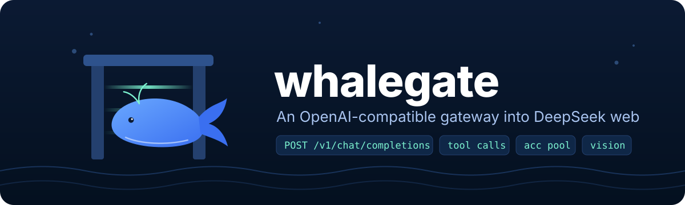
</p>

<p align="center">
  
  
  
  
  
</p>

**whalegate** turns your own `chat.deepseek.com` web sessions into a standard OpenAI-style `/v1/chat/completions` endpoint. It pools several accounts, fails over between them, streams over SSE, reads images, and translates OpenAI `tools` to and from DeepSeek's DSML format. Agents like Cline, Continue, LiteLLM, the OpenAI SDKs and `dsh` can use it as if it were the real API.

> [!WARNING]
> **Use the official API for real work.** [platform.deepseek.com](https://platform.deepseek.com/) is cheap, has an SLA, and doesn't risk your account. whalegate exists for learning, protocol research and personal automation on **your own** account. Automating the web app may violate DeepSeek's Terms of Service and get the account locked. Don't resell or share access. You use it at your own risk ([MIT](LICENSE), no warranty).

---

## Contents

- [Features](#features)
- [How it works](#how-it-works)
- [Quick start](#quick-start)
- [Adding accounts](#adding-accounts)
- [Using the API](#using-the-api)
- [Tool calling](#tool-calling)
- [Images (vision)](#images-vision)
- [Reasoning effort](#reasoning-effort)
- [Stateful conversations](#stateful-conversations)
- [Account pool & failover](#account-pool--failover)
- [Dashboard](#dashboard)
- [Moving accounts between machines](#moving-accounts-between-machines)
- [Updating](#updating)
- [Configuration](#configuration)
- [HTTP endpoints](#http-endpoints)
- [Using with dsh (PTC mode)](#using-with-dsh-ptc-mode)
- [Cloudflare Worker fan-out](#cloudflare-worker-fan-out-optional)
- [Project layout](#project-layout)
- [Limitations](#limitations)

---

## Features

| | |
|---|---|
| 🔌 **OpenAI-compatible** | `POST /v1/chat/completions` (stream and non-stream) and `GET /v1/models`. Responses use the OpenAI shape, including `usage` and `cached_tokens` |
| 🛠️ **Tool calling** | Supports `tools`, `tool_choice` (`auto` / `none` / `required` / named) and `parallel_tool_calls`. Arguments are validated against your JSON Schema, and the gateway retries with a targeted correction before a broken call ever reaches the client |
| 🖼️ **Vision** | Accepts `image_url` (data URL or http), Anthropic-style base64 `image`, and images inside tool results. Images are uploaded to DeepSeek and cached per account |
| 🧠 **DeepThink** | `reasoning_effort` maps to `none` / `auto` / `max`. Reasoning streams as `reasoning_content` |
| 🐳 **Account pool** | Least-busy scheduling with a per-account concurrency cap, burst limiter and escalating cooldowns |
| 🔁 **Failover** | An error, empty or truncated stream moves the request to another account (up to 3 attempts) |
| 🧵 **Stateful** | Continues the same web conversation and sends only the new messages, so long agent loops stay fast and cheap |
| 🔐 **Proof-of-work** | Built-in solver for `DeepSeekHashV1`, with optional prefetch for the next request |
| 🌐 **Session capture** | Log in once in Chrome. The gateway grabs the token and cookies over CDP and refreshes the cookies every 5 minutes |
| 📦 **One-line install** | Prebuilt static binaries for Linux (x86_64/arm64), macOS and Windows. The installer starts the gateway on login and configures dsh |
| 🔄 **Self-update** | The dashboard checks GitHub Releases and, on one click, downloads, checksum-verifies, installs and restarts into the new build |
| 📦 **Portable accounts** | Export the pool as a file or clipboard JSON and import it on another machine; merging is idempotent |
| 📊 **Dashboard** | Accounts, live logs, token usage with "what this would cost on the API", latency p50/p90, and settings with graceful restart |

---

## How it works

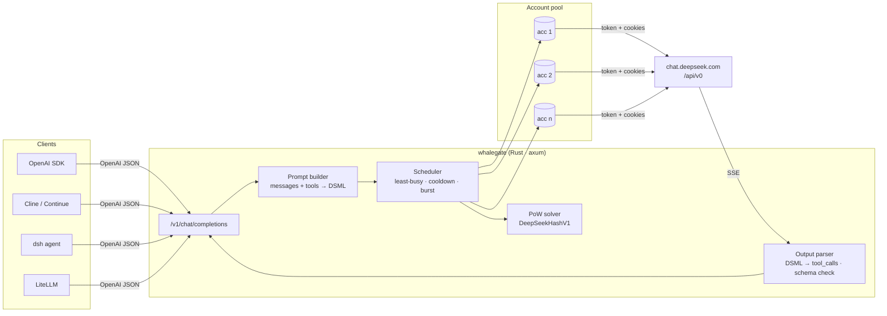

### Lifecycle of one request

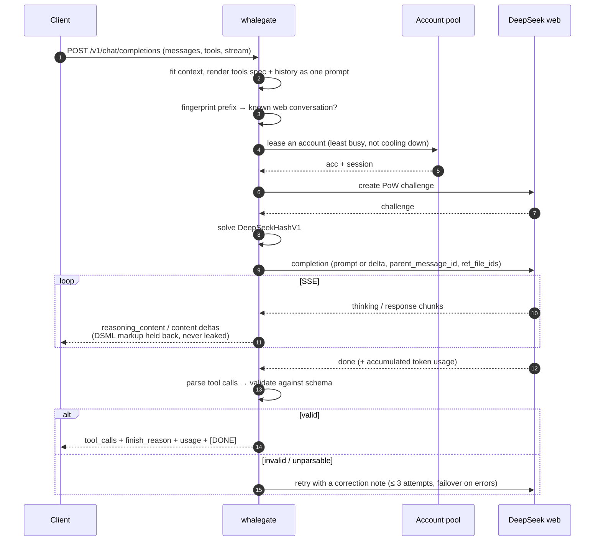

---

## Quick start

### Install (recommended)

**Linux / macOS**
```sh
curl -fsSL https://raw.githubusercontent.com/RuriMeiko/whalegate/main/install.sh | sh
```

**Windows** (PowerShell)
```powershell
irm https://raw.githubusercontent.com/RuriMeiko/whalegate/main/install.ps1 | iex
```

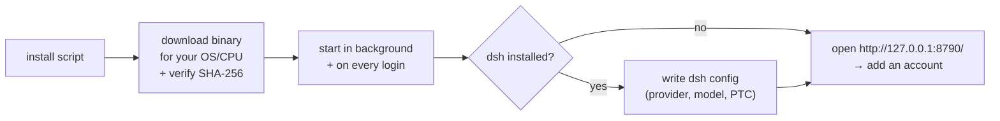

| | Linux | macOS | Windows |
|---|---|---|---|
| Binary | `~/.local/bin/whalegate` | `~/.local/bin/whalegate` | `%LOCALAPPDATA%\whalegate\whalegate.exe` |
| Runs via | `systemd --user` unit `whalegate` | launchd agent `io.github.rurimeiko.whalegate` | hidden Startup entry |
| Logs | `journalctl --user -u whalegate -f` | `~/Library/Logs/whalegate.log` | dashboard → **log** |

Installer options are environment variables: `WHALEGATE_VERSION=v0.4.0`, `WHALEGATE_PORT=8790`, `WHALEGATE_NO_SERVICE=1` (binary only), `WHALEGATE_NO_DSH=1`. Re-running the installer upgrades in place. Prefer to click? Grab an archive from [Releases](https://github.com/RuriMeiko/whalegate/releases) and run `whalegate` (or double-click `whalegate.exe`).

### Build from source

Requires Rust ≥ 1.75.

```bash
git clone https://github.com/RuriMeiko/whalegate.git ~/whalegate
cd ~/whalegate
cargo build --release          # → target/release/whalegate
./target/release/whalegate     # dashboard: http://127.0.0.1:8790/

# background service for a source checkout at ~/whalegate
mkdir -p ~/.config/systemd/user && cp deploy/whalegate.service ~/.config/systemd/user/
systemctl --user daemon-reload && systemctl --user enable --now whalegate
```

### CLI

| Command | What it does |
|---|---|
| `whalegate` / `whalegate serve` | Run the gateway (default) |
| `whalegate setup-dsh [--all] [--preset ptc\|standard] [--profile <dir>]... [--url <base>] [--context <tokens>]` | Point dsh at this gateway (`--all` = every profile on the machine) |
| `whalegate version` | Print the version |
| `whalegate whoami` | Print the current user for the first stored account |
| `whalegate chat "<prompt>"` | Send one raw prompt and dump the SSE stream |
| `whalegate chatraw "<prompt>" <thinking> <search>` | Same, with DeepThink and search toggles, for debugging |

---

## Adding accounts

Accounts are stored in `~/.whalegate/accounts.json`, which you can override with `DS_ACCOUNTS_PATH`. Upgrading from ds-harness moves `~/.ds-harness` there automatically. That file holds **live session tokens**: never commit or share it.

### Option 1: Chrome login (recommended)

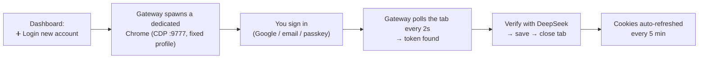

- **🔍 Scan tabs & save sessions** captures every already-logged-in `chat.deepseek.com` tab from your main Chrome. Start Chrome with `--remote-debugging-port=9333` first.
- **🏗️ Build profile** (~40s, do it once) warms the login profile by browsing real sites. This makes `Current device environment error` much less likely.
- If the same DeepSeek user logs in again, the existing account's token is replaced rather than duplicated.

### Option 2: paste a token

On a logged-in `chat.deepseek.com` tab, open DevTools → Console and run:

```js
copy(localStorage.userToken)
```

Paste the result into **Add account manually** on the dashboard. Any of these shapes is accepted: `{"value":"…","__version":"0"}`, a quoted string, `Bearer …`, or the bare token. The token is verified before it is saved, and cookies are optional. You can also add one through the API:

```bash
curl -X POST http://127.0.0.1:8790/api/accounts \
  -H 'content-type: application/json' -d '{"token":"<token>","label":"main"}'
```

---

## Using the API

The single model is `deepseek-web`. The legacy aliases `deepseek-web-r1` and `deepseek-web:max` are still accepted.

### curl

```bash
curl http://127.0.0.1:8790/v1/chat/completions \
  -H "Content-Type: application/json" \
  -d '{
    "model": "deepseek-web",
    "messages": [{"role": "user", "content": "Explain the borrow checker in 3 sentences."}],
    "stream": true
  }'
```

### OpenAI Python SDK

```python
from openai import OpenAI

client = OpenAI(base_url="http://127.0.0.1:8790/v1", api_key="anything-unless-DS_API_KEY-is-set")

resp = client.chat.completions.create(
    model="deepseek-web",
    reasoning_effort="max",                      # none | auto | max
    messages=[{"role": "user", "content": "Prove that √2 is irrational."}],
)
print(resp.choices[0].message.reasoning_content)  # DeepThink trace
print(resp.choices[0].message.content)
```

### Extra request fields

Pass these as `extra_body` in the SDKs.

| Field | Type | Default | Meaning |
|---|---|---|---|
| `reasoning_effort` | string | `DS_DEFAULT_EFFORT` | `none` = fast, `auto` = think on user turns only, `max` = always think. `reasoning.effort` also works |
| `thinking` | bool | `false` | Legacy switch for DeepThink |
| `search` | bool | `false` | DeepSeek web search |
| `new_thread` | bool | `false` | Start a fresh web conversation instead of continuing a matching one |

### Compatibility notes

- `usage` comes from the web app's real `accumulated_token_usage`. When it is missing, a per-script estimate is used, which lands within about 25% of measured values. `prompt_tokens_details.cached_tokens` counts the part of the context that was already in the web conversation.
- A `429` includes `Retry-After`. SSE sends a keep-alive every 10s. Upstream failures return a clear `error` object.
- The web app has no equivalent for `temperature`, `top_p`, `max_tokens`, `stop`, `response_format` or `n > 1`, so they are ignored.

---

## Tool calling

DeepSeek web has no tool API. whalegate emulates one by rendering your OpenAI `tools` into the same **DSML** block format the model already uses, then parsing it back:

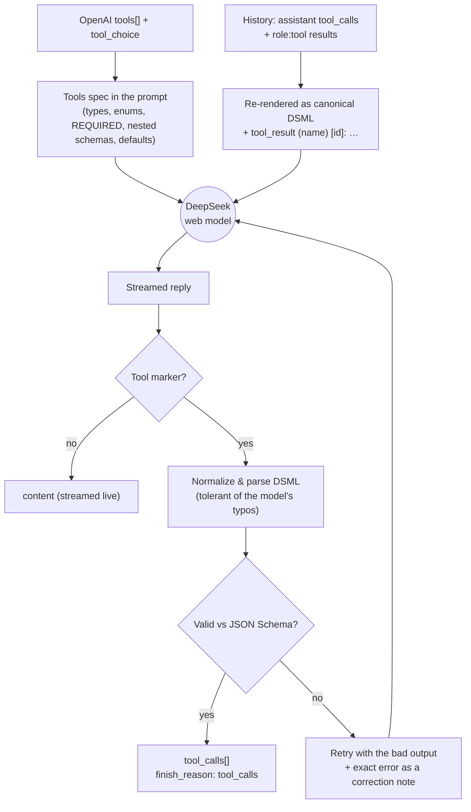

What the model writes, and what your client receives:

<table>
<tr><th>Model output (DSML)</th><th>Client receives</th></tr>
<tr><td>

```text
Let me check the repo.
<｜｜DSML｜｜ calls>
<｜｜DSML｜｜ invoke name="bash">
<｜｜DSML｜｜ parameter name="command" string="true">ls -la</｜｜DSML｜｜ parameter>
<｜｜DSML｜｜ parameter name="timeout" string="false">30</｜｜DSML｜｜ parameter>
</｜｜DSML｜｜ invoke>
</｜｜DSML｜｜ calls>
```

</td><td>

```json
{
  "content": "Let me check the repo.",
  "tool_calls": [{
    "id": "call_9f2c41ab07de",
    "type": "function",
    "function": {
      "name": "bash",
      "arguments": "{\"command\":\"ls -la\",\"timeout\":30}"
    }
  }]
}
```

</td></tr>
</table>

### What makes it behave like a real API

- **No false positives.** Calls are only extracted when the request actually has `tools`. Fallback formats (JSON, XML-ish) count only when they end the reply and name a tool you declared. HTML in an answer, or an example `<bash command="…"/>` in prose, stays text.
- **Schema validation.** Types, `enum`, `required`, nested `properties` / `items`, `anyOf` / `oneOf`. Values are also coerced to the declared type: `"50"` becomes `50`, and `123` becomes `"123"` for string params.
- **Repair retries.** A broken call is never retried blind. The next attempt includes the model's own output plus the concrete problem, for example `todo: "items[0].status" must be one of "todo"|"done"`, so the model fixes exactly that.
- **`tool_choice`.** `none` returns plain text. `required` and named choices force a call and retry if the model answers in prose. A named tool that isn't declared returns `400 invalid_request_error`.
- **`parallel_tool_calls: false`** keeps a single call.
- **Markup never leaks.** DSML is held back from `content`, and stripped from `reasoning_content` when the model drafts calls while thinking.
- **History round-trips.** Previous calls are re-rendered in canonical DSML. Empty tool results show as `(no output)`, so the model doesn't re-run a silent `mkdir`.

### Example: an agent loop

```python
tools = [{
    "type": "function",
    "function": {
        "name": "bash",
        "description": "Run a shell command",
        "parameters": {
            "type": "object",
            "properties": {"command": {"type": "string"}, "description": {"type": "string"}},
            "required": ["command", "description"],
        },
    },
}]

messages = [{"role": "user", "content": "How much disk is free on /?"}]
while True:
    r = client.chat.completions.create(model="deepseek-web", messages=messages,
                                       tools=tools, reasoning_effort="auto")
    msg = r.choices[0].message
    messages.append(msg)
    if not msg.tool_calls:
        print(msg.content)
        break
    for call in msg.tool_calls:
        output = run(call)                       # your executor
        messages.append({"role": "tool", "tool_call_id": call.id, "content": output})
```

---

## Images (vision)

```python
client.chat.completions.create(model="deepseek-web", messages=[{
    "role": "user",
    "content": [
        {"type": "text", "text": "What is wrong in this screenshot?"},
        {"type": "image_url", "image_url": {"url": "data:image/png;base64,iVBORw0..."}},
    ],
}])
```

- Accepts `image_url` (data URL or public `http(s)` URL; private and internal addresses are refused), Anthropic-style `{"type":"image","source":{…}}`, and images returned **inside tool results**, such as a `read_image` tool.
- Each image is uploaded through DeepSeek's file endpoint (with its own PoW) and attached with `ref_file_ids`. Uploads are cached per account by content hash.
- Up to the 4 most recent distinct images are sent per request. The per-image size cap is `DS_MAX_IMAGE_MB` (default 20).

---

## Reasoning effort

| `reasoning_effort` | DeepThink | Best for |
|---|---|---|
| `none` (also `off`, `minimal`) | never | Fast answers and simple tool loops |
| `auto` | on user turns, **off** on steps that only continue after a `tool` result | Agents. Thinking steps take ~10–44 s and non-thinking steps ~2 s, so tool loops get several times faster |
| `max` (any other value) | every step | Hard problems |

When the client sends nothing, `DS_DEFAULT_EFFORT` applies (default `none`). Title-generation requests from clients never think.

---

## Stateful conversations

Agents resend the whole history every step. whalegate fingerprints each conversation prefix plus the tool-call ids it issued. When the next request extends a known prefix, only the **new** messages go to the same web conversation, using `parent_message_id`.

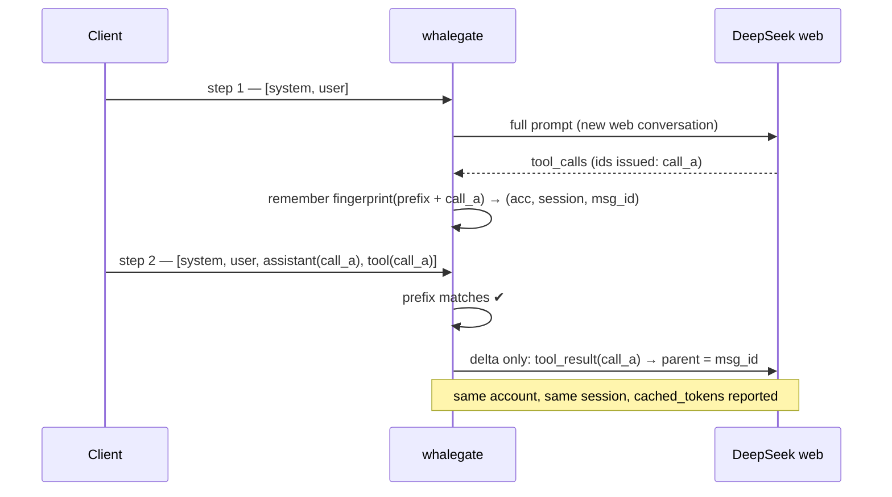

The gateway falls back to sending the full context, on any account, when the prefix doesn't match, the holding account stays busy for more than 4s, the tools change, or the conversation grows past `DS_CONV_MAX_CHARS`. Idle web conversations are deleted after `DS_CONV_TTL`. Set `DS_STATEFUL=0` to always send everything.

---

## Account pool & failover

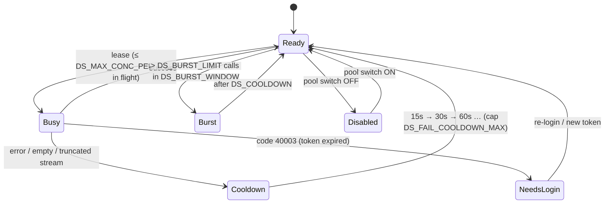

- Each request gets up to **3 attempts**. Upstream failures move to another account. Model mistakes (a bad tool call) retry with a correction note and don't penalize the account.
- When no account is free, the request waits up to `DS_QUEUE_WAIT_SECS`, then returns `429` with `Retry-After`.
- A stream that stalls for 90s or breaks mid-way counts as truncated and is retried, not returned as complete.
- The in-flight lease lives for the whole stream, even if the client disconnects, so the concurrency cap really holds.

---

## Dashboard

Open `http://127.0.0.1:8790/`. It is loopback-only.

- **Accounts:** add, verify, reset, edit label or token, enable/disable in the pool, bulk verify/reset, and duplicate-user detection. **Verify** is not just an auth check: it sends one minimal real completion on a throwaway session, because a throttled account still passes the auth endpoint. The result is alive, throttled, auth_dead or unknown, and only alive clears a throttle label.
- **Usage:** tokens per hour (cache miss / cache hit / output), and what the same traffic would cost on the official API. Prices are fetched live every 6h from DeepSeek's pricing page, peak hours are included, and there is a monthly projection. Data lives in `usage.json` next to `accounts.json`.
- **Latency:** p50/p90 over the last hour, plus the error count.
- **Live logs:** SSE stream with filters and search. Useful tags include `[toolcall-invalid]`, `[toolcall-unparsed]`, `[conv]`, `[ds-stall]` and `[ds-fail]`.
- **Settings:** verified knobs only. Saving waits until no request is in flight, then the process re-execs itself (same PID, picks up a new build) and the page reloads. **Hard reset** restarts immediately.
- **Export / import:** move the whole account pool to another machine as a JSON file or straight through the clipboard. Import merges by DeepSeek user id, so running it twice is safe; it never deletes accounts you already have.
- **Updates:** the dashboard checks GitHub Releases on load and every 30 minutes. When a newer tag exists a banner appears; one click downloads the prebuilt binary, verifies its SHA-256, swaps it in place and re-execs, and the page reloads by itself once the new process is up.

---
## Moving accounts between machines

The pool lives in `~/.whalegate/accounts.json`, which holds session tokens — the file *is* the credential. Two ways to carry it over, both from the dashboard:

- **Export → Tải file** downloads `whalegate-accounts-<ts>.json`; copy it over and use **Import → chọn file** on the other machine.
- **Export → Copy clipboard** puts the same JSON on the clipboard (falling back to a hidden textarea when the browser blocks the async clipboard API); paste it into the Import dialog on the target machine.

Import merges instead of replacing. Accounts are matched by DeepSeek user id first, then by token, so importing the same bundle twice adds nothing the second time. Without *overwrite*, accounts that already exist are skipped; with it, their token and cookies are replaced (and their stale web sessions cleared). Nothing is ever deleted.

> [!WARNING]
> An exported bundle contains every account's token and cookies. Anyone holding it can use those sessions. Move it over a channel you trust, delete the file afterwards, and never commit it — `accounts.json` and `*.session` are already in `.gitignore`.

---

## Updating

`GET /api/update` reads `https://api.github.com/repos/RuriMeiko/whalegate/releases/latest`, compares it with the running `CARGO_PKG_VERSION` and returns `{current, latest, has_update, notes, url}`.

`POST /api/update` then:

1. downloads `whalegate-<target>.tar.gz` (`.zip` on Windows) and `SHA256SUMS.txt` for the newest tag,
2. verifies the SHA-256 (implemented in-tree, no extra dependency),
3. extracts the binary, copies it next to the running one and `rename`s it into place — atomic, and safe while the old inode is still executing,
4. answers the HTTP request, then re-execs so the new binary takes over the same PID.

The dashboard checks on load and every 30 minutes, shows a banner when a newer tag exists, and reloads the page once `/api/restart` reports a new boot id. Requests in flight are cut; agents such as dsh retry them.

Windows locks a running `.exe`, so the rename in step 3 cannot work there. Instead the updater copies the new binary to `whalegate.exe.new` and writes a `whalegate.update.bat` next to it; the restart path launches that script, which waits for the old process to exit, replaces the file with `move /y`, relaunches the app and deletes itself. The script only runs while both files still exist, so an abandoned update never replays.

If you installed with `install.sh` / `install.ps1` there is nothing else to do — the binary is replaced in place and the service config is untouched. To update from a shell instead, re-run the installer:

```sh
curl -fsSL https://raw.githubusercontent.com/RuriMeiko/whalegate/main/install.sh | sh
```

---


## Configuration

Precedence: value saved on the dashboard → `DS_*` environment variable → default. Rows marked ⚙️ are editable on the dashboard.

| Variable | Default | Meaning |
|---|---|---|
| `DS_PORT` | `8790` | Listen port (always binds `127.0.0.1`) |
| `DS_API_KEY` | – | If set, `/v1/*` requires `Authorization: Bearer <key>` |
| `DS_ACCOUNTS_PATH` | `~/.whalegate/accounts.json` | Account store. Settings, usage and samples live next to it |
| ⚙️ `DS_STATEFUL` | `1` | Continue web conversations and send deltas only |
| ⚙️ `DS_POW_PREFETCH` | `1` | Fetch and solve the next PoW ahead of time |
| ⚙️ `DS_DEFAULT_EFFORT` | `none` | Effort when the client doesn't specify one |
| ⚙️ `DS_CONTEXT_TOKENS` | `512000` | `context_length` advertised in `/v1/models`. The web app accepts ≥512K, while ~1.1M returns an empty stream |
| ⚙️ `DS_PROMPT_MAX_CHARS` | `1822000` | Over budget: trim old tool results first, then drop the oldest turns |
| ⚙️ `DS_MAX_CONC_PER_ACC` | `2` | In-flight requests per account. More than 2 tends to get rate-limited |
| ⚙️ `DS_TZ_OFFSET` | `25200` | Timezone offset in seconds sent to the web app and used for daily stats |
| `DS_CONV_TTL` | `1800` | Delete idle web conversations after this many seconds |
| `DS_CONV_MAX_CHARS` | `1200000` | Maximum size of one stateful conversation |
| `DS_SESSION_ROTATE` | `30` | Turns on a shared (tool-less) session before rotating |
| `DS_QUEUE_WAIT_SECS` | `120` | Wait for a free account before returning `429` |
| `DS_FAIL_COOLDOWN_MAX` | `600` | Cap for the escalating failure cooldown |
| `DS_BURST_LIMIT` / `DS_BURST_WINDOW` / `DS_COOLDOWN` | `6` / `30` / `10` | Per-account burst limiter |
| `DS_MAX_IMAGE_MB` | `20` | Maximum size per image |
| `DS_READ_TIMEOUT_SECS` | `120` | Socket read timeout (restart required) |
| `DS_CHROME_BIN` | auto | Chrome/Chromium path for login |
| `DS_LOGIN_CDP_PORT` / `DS_LOGIN_PROFILE` | `9777` / `~/.whalegate/login-profile` | Dedicated login Chrome |
| `DS_RESET_LOGIN_PROFILE` | – | `1` wipes the login profile before opening |
| `DS_CN_HOLIDAYS` | – | Extra Chinese holidays (`YYYY-MM-DD,…`) for peak-price math |
| `DS_DEBUG_SSE` | `0` | Dump raw SSE to `/tmp/ds_debug_sse.log` |

---

## HTTP endpoints

| Method | Path | Description |
|---|---|---|
| `POST` | `/v1/chat/completions` | OpenAI-compatible chat |
| `GET` | `/v1/models` | Model list (`context_length`, `reasoning_efforts`, modalities) |
| `GET` | `/` | Dashboard |
| `GET` / `POST` | `/api/accounts` | List / add accounts (`{token, label?}` or `{token, cookies}`) |
| `PATCH` / `DELETE` | `/api/accounts/{id}` | Edit label or token / delete |
| `POST` | `/api/accounts/{id}/verify` · `/reset` · `/pool` | Probe with a real chat (returns `probe: alive\|throttled\|auth_dead\|unknown`) / clear errors and sessions, then probe / `{"pool_enabled": bool}` |
| `POST` | `/api/capture` · `/api/login_start` · `/api/build_profile` | Chrome session capture, login flow, profile warm-up |
| `GET` | `/api/stats` · `/api/usage` | Pool state (in-flight, cooldowns, stateful hit rate) / usage, cost and latency |
| `GET` | `/api/logs` · `/api/logs/stream` | Logs as JSON / SSE |
| `GET` / `POST` | `/api/settings` | Read or update settings (`null` resets a key) |
| `GET` / `POST` | `/api/dsh` | dsh status (lists every profile found) / write the dsh config (`{"preset": "ptc"\|"standard", "profiles": ["desktop","web"]}`; omit `profiles` or set `"all": true` for every profile) |
| `GET` / `POST` | `/api/restart` | Status / `{"mode": "idle" \| "now" \| "cancel"}` |
| `GET` | `/api/accounts/export` | Download the whole pool as a JSON bundle (contains tokens — treat as a secret) |
| `POST` | `/api/accounts/import` | Merge a bundle or `{accounts: [...]}`. `dry_run` previews, `overwrite` replaces tokens of known users |
| `GET` / `POST` | `/api/update` | Check the latest GitHub release / download, verify and install it, then restart |

> [!IMPORTANT]
> `/` and `/api/*` only answer **loopback**, even when the port is exposed. `/v1/*` answers anyone, so set `DS_API_KEY` before exposing it. A reverse proxy on the same machine makes every request look like loopback, so never proxy the dashboard publicly.

---

## Using with dsh (PTC mode)

dsh (`@deepseek-ai/dsh`, on Linux, macOS and Windows) reads its model list from the profile's patch file, not from `/v1/models`. whalegate writes that file for you. Use either:

- **Dashboard → dsh** — it lists every profile under `$DSH_HOME/profiles`, shows which already point here, and writes the ones you tick (choose PTC or standard), or
- **`whalegate setup-dsh --all`** (`--preset standard` for the classic preset, `--profile <dir>` repeatable to be explicit). The installers run this automatically when dsh is present.

**Which profile?** dsh on a terminal uses `web`. **DeepSeek Harness Desktop** (Windows/macOS) uses `desktop`, a profile the Electron app owns — that is why writing only `web` left Desktop users without the model. Quit the Desktop app while configuring, then reopen it. Other profiles (`headless`, `acp`, custom names) work the same way.

Either way the config is idempotent, backs up `cordis.patch.yml` to `.bak.<timestamp>`, and touches nothing else in the file:

```yaml
- id: llm-pi-ai
  config:
    providers:
      whalegate:
        api: openai-completions
        baseURL: http://127.0.0.1:8790/v1
        headers: { Authorization: Bearer whalegate-local }   # DS_API_KEY if you set one
        compat: { supportsDeveloperRole: false, supportsReasoningEffort: true, supportsUsageInStreaming: true }
        models:
          - id: deepseek-web
            contextWindow: 512000        # derived, see below
            maxTokens: 32768
            input: [text, image]
            reasoningEfforts: { off: none, low: auto, max: max }
- id: agent-default-model
  config: { provider: whalegate, model: deepseek-web }
- id: agent-preset-registry
  config: { selectedDefault: ptc }
```

- **The key goes straight into `headers`.** dsh's OpenAI transport refuses to send a request without a credential, even to a keyless local server. Writing it inline means there's no `apiKeyEnv` or `.env` to set, which also fixes `no credential for provider route`.
- **`contextWindow` is chosen so history never overflows.** dsh compacts at 80% of the window, while whalegate has to trim history itself once a prompt passes `DS_PROMPT_MAX_CHARS` (1.822M characters). Assuming a worst case of ~4 characters per token plus 10% headroom for the tool spec, the window is `DS_PROMPT_MAX_CHARS × 0.9 ÷ 4 ÷ 0.8`, capped by `DS_CONTEXT_TOKENS`. That gives ≈512K by default, so dsh always summarizes before the gateway would cut anything. Change *Prompt cap* on the dashboard and run the setup again to follow it.

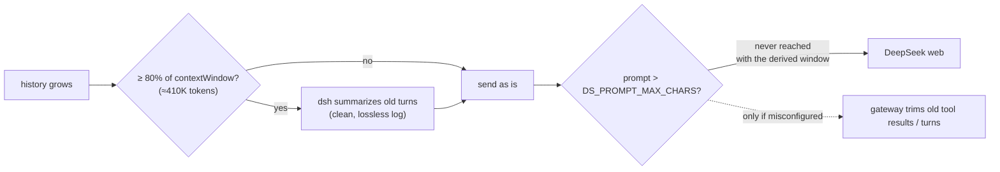

**Why PTC (Programmatic Tool Calling)?** Instead of one schema per tool, the model sees a single `run_code` tool plus a generated TypeScript SDK, and writes one program that chains many tools:

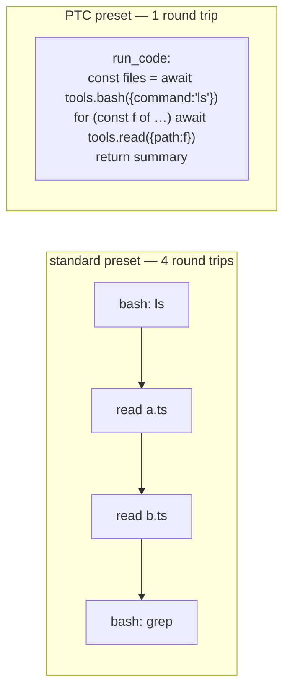

Only what the program prints or returns comes back into the context. Through whalegate this means far fewer requests to DeepSeek web, which brings fewer throttles and less fixed per-turn latency. The trade-off is that the whole step rides on one `code` argument, so an SDK mistake fails the whole program.

---

## Cloudflare Worker fan-out (optional)

`worker/ds-proxy.js` round-robins clients across several whalegate instances (different IPs or VPSes), with light rate limiting and an optional KV-backed cursor.

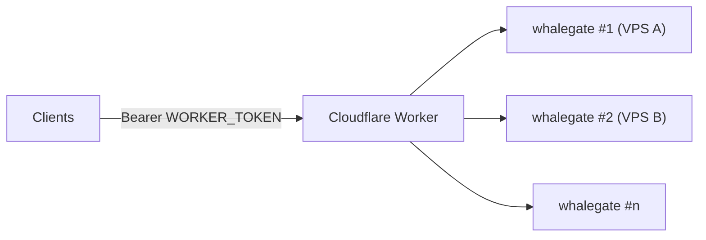

```bash
cd worker
npx wrangler deploy
npx wrangler secret put UPSTREAMS      # ["https://wg1.example","https://wg2.example"]
npx wrangler secret put WORKER_TOKEN   # bearer token clients must send
```

---

## Project layout

```text
src/
├── main.rs            CLI: serve | whoami | chat | chatraw
├── chat.rs            /v1/chat/completions — one core (run_chat) for stream & non-stream,
│                      failover, repair retries, tool_choice, stateful continuation
├── server.rs          router, account pool, dashboard API, DSML parser & schema validator,
│                      prompt rendering
├── client.rs          HTTP + SSE client for chat.deepseek.com, stall detection
├── pow.rs             Keccak-f[1600] + DeepSeekHashV1 proof-of-work
├── chrome_capture.rs  CDP login, tab capture, cookie refresh
├── settings.rs        dashboard settings (saved → env → default)
├── setup_dsh.rs       `whalegate setup-dsh` + dashboard dsh button (cross-platform config writer)
├── usage.rs           token accounting, live API pricing, latency
├── logbuf.rs          in-memory log ring for the live log view
└── ui.html            dashboard (embedded in the binary)
deploy/                systemd unit for source checkouts, dsh setup wrapper
install.sh, install.ps1 one-line installers (Linux/macOS, Windows)
.github/workflows/     release pipeline: static musl, macOS, Windows builds → GitHub release
worker/                Cloudflare Worker fan-out
docs/                  README assets, release notes
```

Malformed tool-call outputs are saved to `~/.whalegate/samples.jsonl`. Replay them against the current parser with:

```bash
cargo test --release replay_samples -- --ignored --nocapture
```

The `DeepSeekHashV1` PoW is SHA3-256 without round 0 of keccak-f, ported 1:1 from [CJackHwang/ds2api](https://github.com/CJackHwang/ds2api).

---

## Limitations

- DeepSeek web is **not** an API. Latency is higher, and endpoints or behavior can change or be blocked at any time.
- Tool calling is prompt-emulated. It is hardened (validation, repair retries, a tolerant parser), but still less exact than a native function-calling API.
- Tool calls arrive in one chunk when the model finishes the block, not as streamed argument deltas.
- Sampling controls (`temperature`, `top_p`, `max_tokens`, `stop`, `response_format`) have no web equivalent.
- No embeddings endpoint.
- Chrome/CDP login is tested on Linux. macOS and Windows builds find Chrome in its standard locations (or `DS_CHROME_BIN`), but are less exercised.
- Release binaries aren't code-signed, so macOS Gatekeeper and Windows SmartScreen may ask once.

---

## License

[MIT](LICENSE) © 2026 RuriMeiko. **Use responsibly, and buy the official API if you need reliability.**
