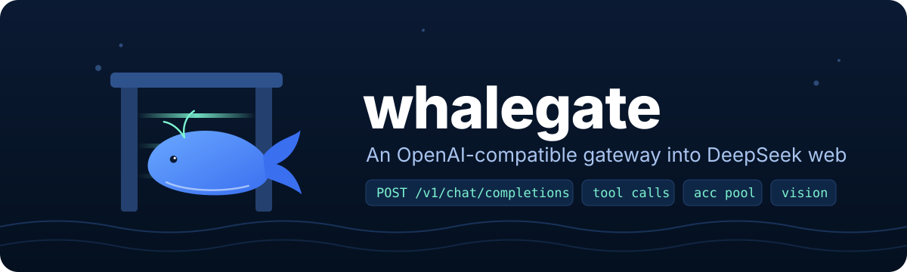

**Login through Chrome no longer fails with "Lỗi môi trường thiết bị hiện tại", and every account now exits from its own IP.** A brand-new browser profile used to be rejected by DeepSeek the first time you clicked *Send code* or *Log in*, because the Shumei device SDK had not finished registering the device yet. whalegate now waits for the device id, reloads the page once, and only then hands the window over.

## Upgrade

From the dashboard, or re-run the installer:

    curl -fsSL https://raw.githubusercontent.com/RuriMeiko/whalegate/main/install.sh | sh

    irm https://raw.githubusercontent.com/RuriMeiko/whalegate/main/install.ps1 | iex

## Fixed

- **Chrome login on a fresh profile.** Measured on a real Chrome: a new isolated context that clicks immediately gets the device-environment toast; after the SDK has a device id and the page is reloaded, the same click shows the normal captcha. It was not the fingerprint, the proxy or CDP: with no fingerprint override at all the error still appeared. `warm_device()` now runs for every `deepseek.com/sign_*` window.

## Added

- **Per-account egress proxy**, pinned by fingerprint seed (http, https, socks5, socks5h). `DS_PROXY_MODE=off|auto|strict`; strict fails instead of leaking the real IP. Settings > Proxy on the dashboard, `GET/POST /api/proxy`, `/api/proxy/unbind`.
- **`whalegate register`**: send the sign-up OTP, verify it and capture the device without a browser, using the same AES + RSA-OAEP body encryption as web 2.7.0. See `docs/register.md`.
- **`live_signup_probe`** (ignored test): opens the per-account Chrome, fills an email, clicks *Send code* and stops at the first toast (fail) or captcha (pass).

## Notes

- Every login still gets its own fingerprint seed and its own Chrome profile; the session saved is the token, the device id and all cookies for `chat.deepseek.com` including httpOnly ones such as `ds_session_id`.
- `cargo test`: 122 passed, 17 ignored (live tests).
